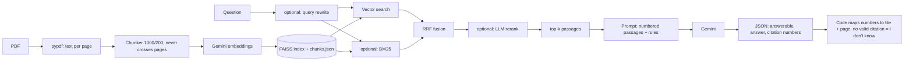

# DocuQuery

RAG document Q&A: upload PDFs, ask questions, get answers grounded in the documents with
file-and-page citations, and an "I don't know" when the documents don't support an answer.

## Architecture


## Setup
```bash
python -m venv .venv && source .venv/bin/activate     # Windows: .venv\Scripts\activate
pip install -r requirements.txt && pip install -e .
cp .env.example .env        # add GEMINI_API_KEY; verify EMBED_MODEL / GEN_MODEL in Google AI Studio
pytest -q                   # offline tests, no key needed
# put PDFs in data/pdfs/ (see DATASET.md), then:
python -m docuquery.cli ingest data/pdfs
streamlit run app.py
```

## Evaluation
See `eval/README.md`. Short version:
```bash
python eval/draft_questions.py            # drafts; YOU verify and move rows to eval/questions.jsonl
python eval/run_eval.py --name baseline
python eval/run_eval.py --name hybrid --hybrid
python eval/run_eval.py --name hybrid_rerank --hybrid --rerank
python eval/run_eval.py --name hybrid_rerank_rewrite --hybrid --rerank --rewrite
python eval/report.py failures baseline
python eval/report.py table baseline hybrid hybrid_rerank hybrid_rerank_rewrite --readme
```

## Results
Generated from `eval/results/*/summary.json`. **No results yet: the evaluation has not been run.**
<!-- RESULTS:START -->
_Not run yet._
<!-- RESULTS:END -->

## Known limitations
- Scanned PDFs are not read (no OCR); tables and figures become flat text.
- Chunks never cross pages, so answers spanning a page break are split.
- Correctness and faithfulness are judged by an LLM; I hand-checked a sample (record how many and your agreement here).
- Small test set: report counts and treat small differences as noise. Drafted questions are biased towards easy retrieval.
- Chunk size, k and prompts were not tuned on a held-out set.
- Single-user local app: no auth, upload size limits or per-user indexes.
