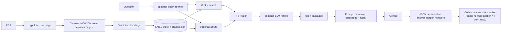

# DocuQuery

RAG document Q&A: upload PDFs, ask questions, get answers grounded in the documents with
file-and-page citations, and an "I don't know" when the documents don't support an answer.

## Architecture


## Setup
```bash
python -m venv .venv && source .venv/bin/activate     # Windows: .venv\Scripts\activate
pip install -r requirements.txt && pip install -e .
cp .env.example .env        # add GEMINI_API_KEY; verify EMBED_MODEL / GEN_MODEL in Google AI Studio
pytest -q                   # offline tests, no key needed
# put PDFs in data/pdfs/ (see DATASET.md), then:
python -m docuquery.cli ingest data/pdfs
streamlit run app.py
```

## Evaluation
See `eval/README.md`. Short version:
```bash
python eval/draft_questions.py            # drafts; YOU verify and move rows to eval/questions.jsonl
python eval/run_eval.py --name baseline
python eval/run_eval.py --name hybrid --hybrid
python eval/run_eval.py --name hybrid_rerank --hybrid --rerank
python eval/run_eval.py --name hybrid_rerank_rewrite --hybrid --rerank --rewrite
python eval/report.py failures baseline
python eval/report.py table baseline hybrid hybrid_rerank hybrid_rerank_rewrite --readme
```

## Results
## Evaluation Results

DocuQuery was evaluated using a 29-question test set to examine retrieval quality, answer correctness, faithfulness, and abstention behavior.

Two configurations were run:

- **Baseline:** Vector-based retrieval.
- **Hybrid:** Vector retrieval combined with BM25 keyword search using Reciprocal Rank Fusion (RRF).

### Results Summary

| Metric | Baseline | Hybrid |
|---|---:|---:|
| Questions evaluated successfully | 20/29 | 12/29 |
| Overall correctness on successful rows | 18/20 (90%) | 10/12 (83.3%) |
| Retrieval Hit@1 | 7/14 (50%) | 2/6 (33.3%) |
| Retrieval Hit@3 | 9/14 (64.3%) | 3/6 (50%) |
| Retrieval Hit@5 | 9/14 (64.3%) | 3/6 (50%) |
| Correct abstention | 6/6 (100%) | 6/6 (100%) |
| Faithfulness | 12/13 (92.3%) | 4/5 (80%) |
| Questions with evaluation errors | 9/29 | 17/29 |

### Findings

- The baseline had higher observed overall correctness than hybrid retrieval on the successfully evaluated rows.
- Both configurations correctly abstained on all six successfully evaluated unanswerable questions.
- The hybrid run encountered more evaluation errors, leaving fewer successful results for comparison.
- These results are preliminary. Because the number of successful rows differs between configurations and many questions errored, they do not establish that one retrieval strategy is definitively better.

### Limitations

- The test set is small.
- Evaluation errors reduced the number of usable results.
- Correctness and faithfulness were assessed using an LLM judge and may contain judgment errors.
- Retrieval and generation parameters have not been systematically tuned on a separate held-out test set.

The raw evaluation outputs and summaries are available in [`eval/results/`](eval/results/). See [`eval/README.md`](eval/README.md) for evaluation details.
<!-- RESULTS:START -->
_Not run yet._
<!-- RESULTS:END -->

## Known limitations
- Scanned PDFs are not read (no OCR); tables and figures become flat text.
- Chunks never cross pages, so answers spanning a page break are split.
- Correctness and faithfulness are judged by an LLM; I hand-checked a sample (record how many and your agreement here).
- Small test set: report counts and treat small differences as noise. Drafted questions are biased towards easy retrieval.
- Chunk size, k and prompts were not tuned on a held-out set.
- Single-user local app: no auth, upload size limits or per-user indexes.
